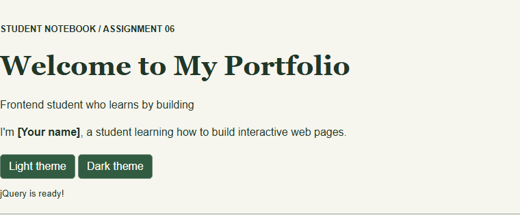
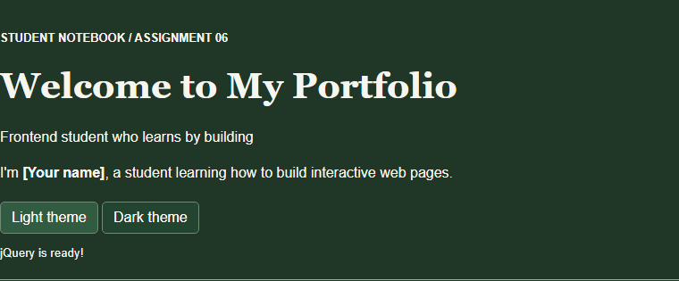
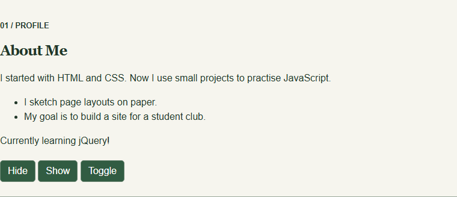
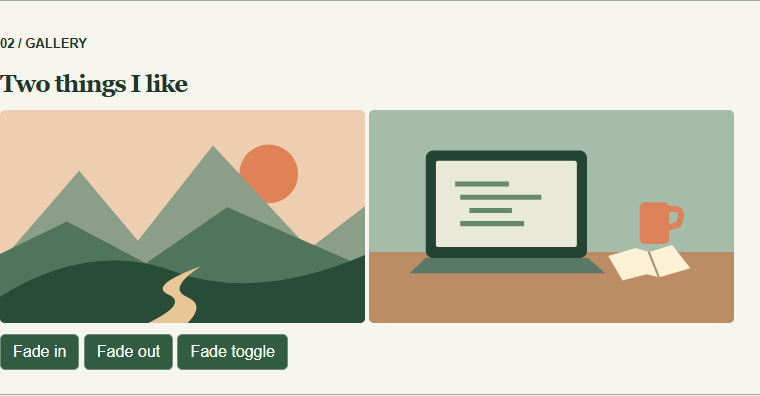
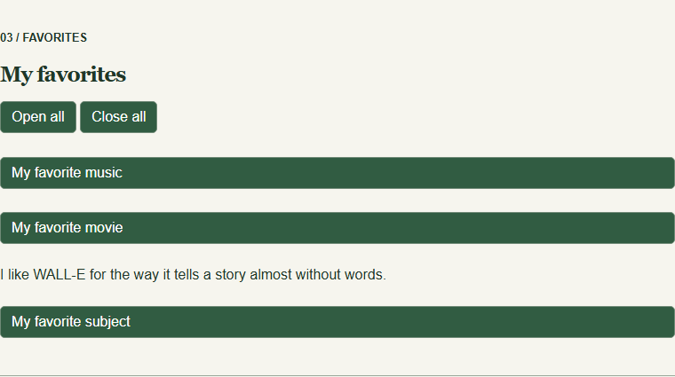
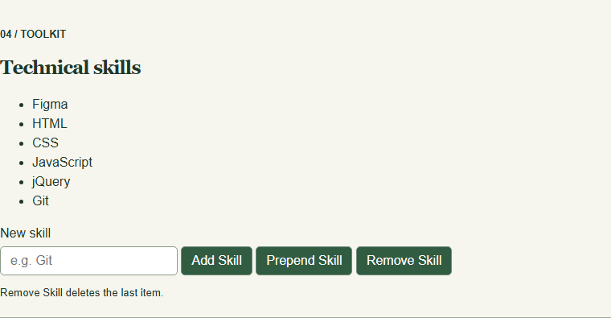
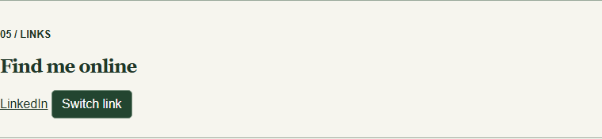
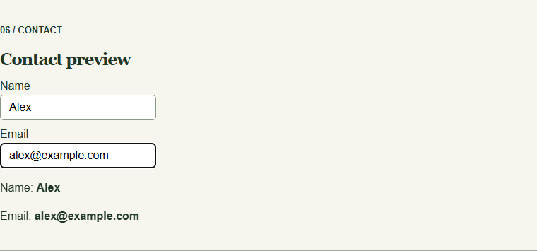
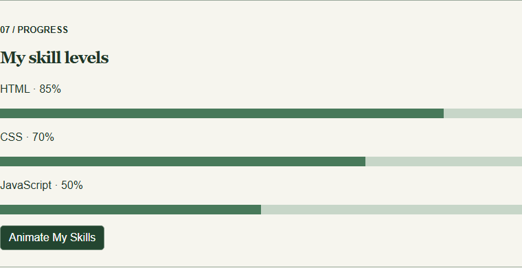

# Assignment 6 · Interactive portfolio

**Name** — Ainabek Chingiskhan   
**Group** — IT-2502

Open `index.html` in a browser. The page loads jQuery 3.7.1 from the CDN and uses the included copy if the CDN is unavailable.

## Part 1 · Getting started

### Task 0 · Setup
Open the browser console and reload. The ready handler prints `jQuery is ready!`. The same message appears under the theme buttons.

### Task 1 · Selectors and CSS
The ID selector updates the headline with `.text()`. Tag and class selectors style the headings and section labels with `.css()`. Light theme and Dark theme change the page colors.

## Part 2 · Effects

### Task 2 · Visibility
Hide, Show and Toggle control the current learning status. The biography and facts stay visible.

### Task 3 · Fade
Fade out hides both illustrations gradually. Fade in brings them back. Fade toggle switches between the two states.

### Task 4 · Slide
Click a heading to slide its panel open or closed. Open all and Close all apply `.slideDown()` and `.slideUp()` to all three panels.

## Part 3 · DOM manipulation

### Task 5 · Skills list
Start with four technical skills. Add Skill appends an item, Prepend Skill places it first, and Remove Skill removes the last item. Empty or whitespace-only input is ignored.

### Task 6 · Link attribute
Switch link changes the destination between GitHub and LinkedIn with `.attr("href", ...)`. The link label updates too.

### Task 7 · Form interaction
The input event reads the name and email with `.val()`. The preview below the form displays both values with `.text()`.

## Part 4 · Animations

### Task 8 · Skill bars
All bars start at zero. Animate My Skills animates HTML to 85%, CSS to 70% and JavaScript to 50%. Click again to animate all three back to zero.

## Work summary
The HTML divides the portfolio into sections. The CSS defines the themes, initially closed panels and empty skill bars. The JavaScript groups the click and input handlers by task inside one document-ready block. Each screenshot shows the corresponding section after using its controls.
